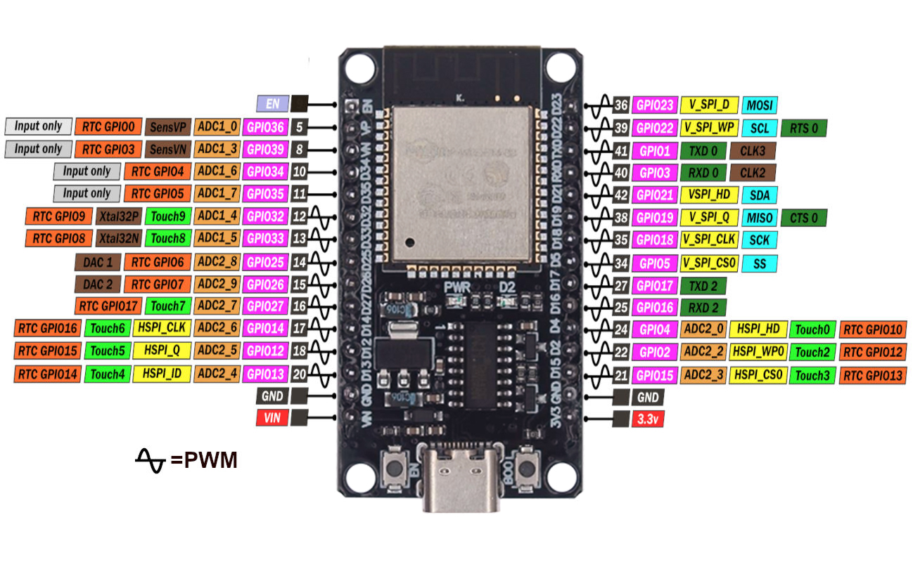

# ESP32 KiCad Library

This repository contains a Symbol, Footprint, and (basic) 3D Model for the [30 pin USB-C ESP32 DevKit](https://www.amazon.com/ESP32-CH340-Development-Board-USB-C/dp/B0DBW6R8SJ), based on [ESP-WROOM-32 MCU module](https://documentation.espressif.com/esp32-wroom-32_datasheet_en.pdf).

> Notice: The libraries are provided in the hope that they will be useful but without a warranty of any kind.

**The libraries in this repository are intended to be used with KiCad version 8.**

Each footprint library is stored as a directory with the .pretty suffix. The footprint files are .kicad_mod files within.

This library is inspired on [Espressif KiCad Library](https://github.com/espressif/kicad-libraries).
